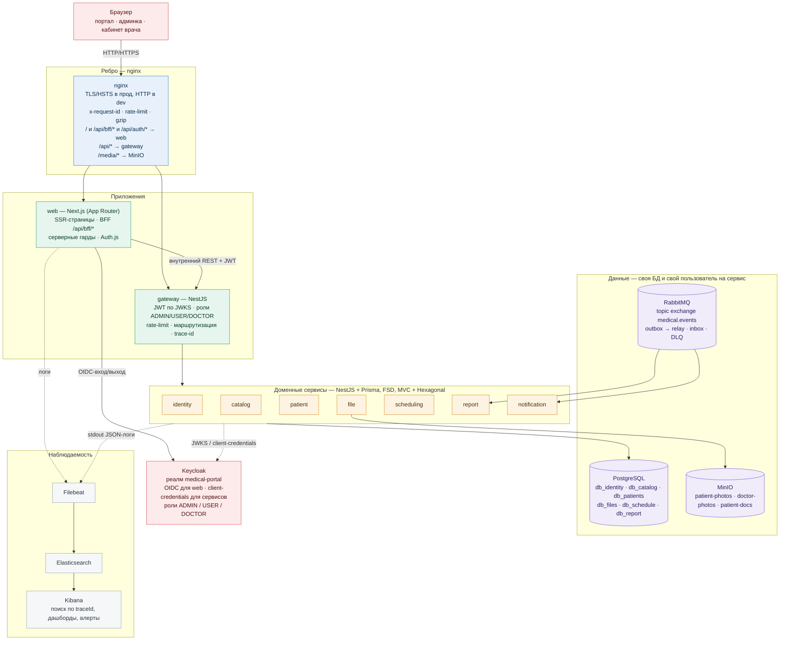
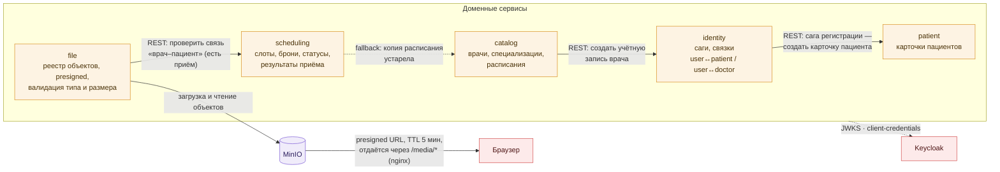
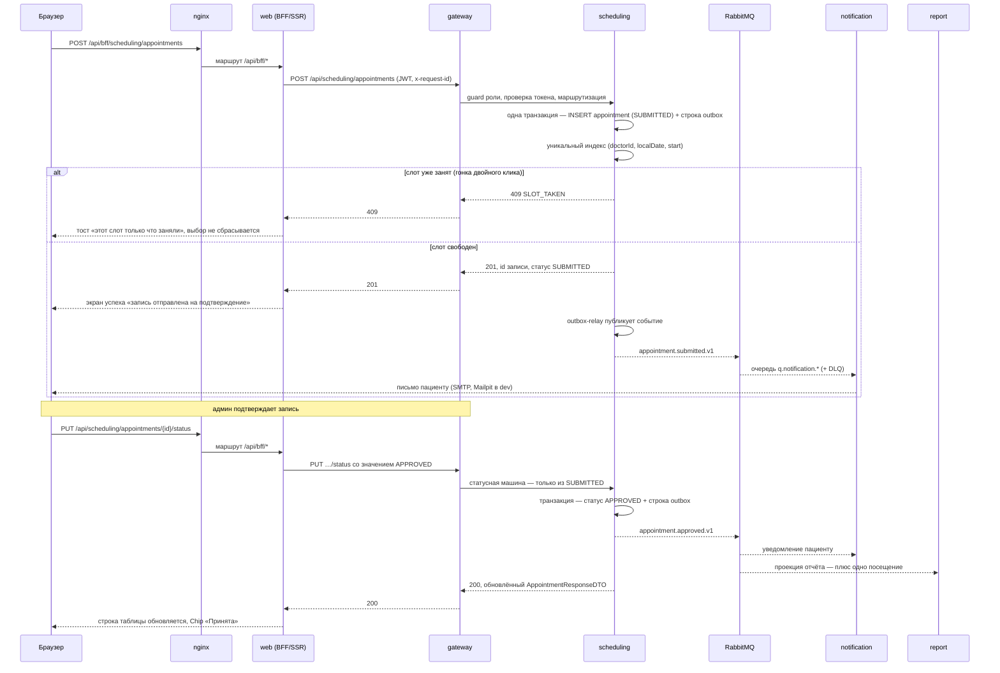
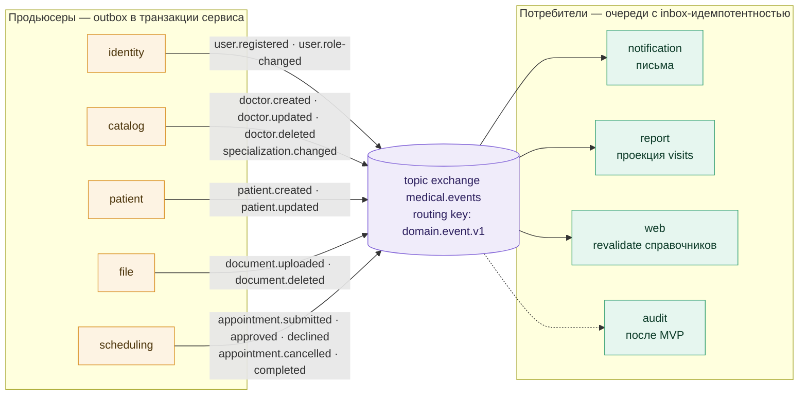

# Графические схемы архитектуры

Визуальное дополнение к [architecture.md](architecture.md) (вариант C). Схемы в Mermaid: открываются в GitHub, VS Code
(превью Markdown) и любом Mermaid-рендерере.

| Схема                                                                            | Что показывает                                                                          |
|----------------------------------------------------------------------------------|-----------------------------------------------------------------------------------------|
| [1. Общая схема](#1-общая-схема-взаимодействия-сервисов)                         | Путь запроса: браузер → nginx → web/gateway → сервисы → данные, Keycloak, наблюдаемость |
| [2. Взаимодействие сервисов](#2-взаимодействие-сервисов-между-собой)             | Межсервисные REST-вызова, файлы и presigned, JWKS                                       |
| [3. Сценарий записи на приём](#3-сценарий-записи-на-приём-бронирование--статусы) | Бронирование через BFF, 409 при гонке, подтверждение админом, события                   |
| [4. Карта событий](#4-карта-событий-rabbitmq)                                    | Продьюсеры → exchange → потребители                                                     |

---

## 1. Общая схема взаимодействия сервисов

**Как читать:**

- сплошные стрелки — синхронный REST, пунктирные — служебные связи (аутентификация, логи, аудит);
- браузер ходит **только** в `web` (`/`, `/api/bff/*`, `/api/auth/*`); прямые вызовы `gateway` из клиента запрещены
  ([fsd §6, №10](fsd.md#6-нарушения-типовые-блокирующие));
- сервисы общаются с `gateway` и между собой — схема [№2](#2-взаимодействие-сервисов-между-собой); асинхронно — через
  RabbitMQ [№4](#4-карта-событий-rabbitmq);
- каждый сервис — своя БД и свой пользователь PostgreSQL, чужие схемы не читаются.

---

## 2. Взаимодействие сервисов между собой

Синхронные межсервисные вызовы (все остальные связи — через события, схема №4):

Правила владения данными — [architecture §5](architecture.md#5-владение-данными): чужие БД не читаются, файлы отдаёт
только `file-service` (владелец / `ADMIN` / врач с приёмом — проверка связи через `scheduling`).

---

## 3. Сценарий записи на приём (бронирование → статусы)

Правила переходов и счётчиков
отчёта — [каноническая таблица статусной машины](functional-spec.md#статусная-машина-записи-канон).

---

## 4. Карта событий RabbitMQ

Гарантии доставки: **at-least-once** (outbox + ретраи + DLQ), идемпотентность потребителей по `eventId` (таблица
`inbox`), replay из DLQ — [architecture §6.3](architecture.md#63-события-rabbitmq). Схемы полезной нагрузки — Zod в
`packages/contracts/events`.

---

## Технические детали схем

| Элемент      | Значение                                                                                                                                                                         |
|--------------|----------------------------------------------------------------------------------------------------------------------------------------------------------------------------------|
| Порты (dev)  | nginx `8080`/`80`, web `3000`, gateway `4000`, Keycloak `8180`, MinIO `9000`/`9001`, RabbitMQ `5672`/`15672`, Elasticsearch `9200`, Kibana `5601`, Mailpit `8025`/`1025`         |
| Домены (dev) | `portal.mp-kit.local`, `kibana.mp-kit.local`, `minio.mp-kit.local`, `mailpit.mp-kit.local`, `rabbitmq.mp-kit.local` (запись в hosts — см. [README репозитория](../../README.md)) |
| Токены       | наружу — JWT Keycloak (realm roles); внутри — тот же JWT или client-credentials; проверка локально по публичному ключу реалма                                                    |
| Контракты    | OpenAPI + Zod в `packages/contracts` → генерация TS-типов для `web` и `gateway`                                                                                                  |
| Логи         | pino (stdout, JSON) → Filebeat → Elasticsearch → Kibana; поиск по `traceId` = `x-request-id`                                                                                     |
